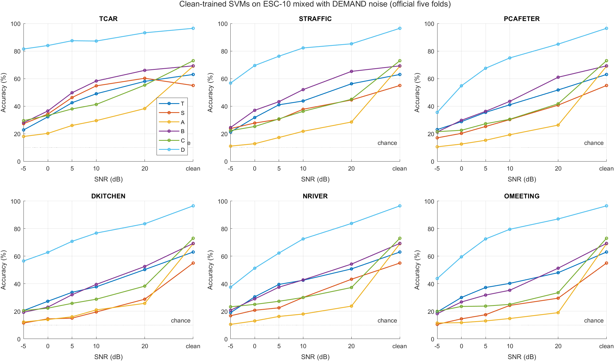
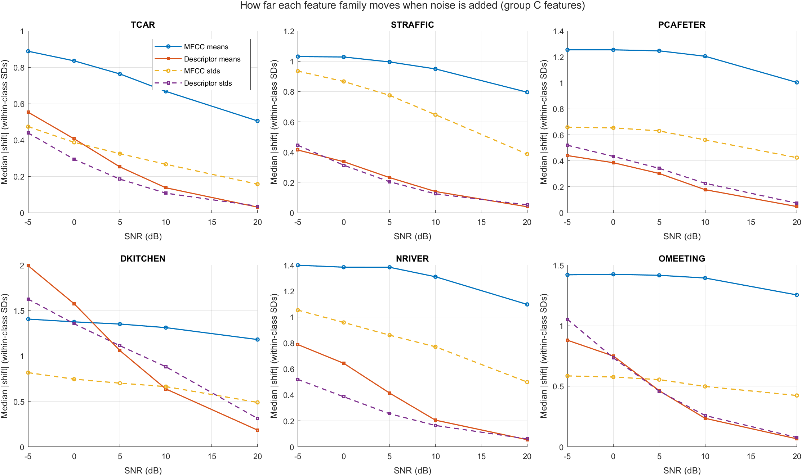
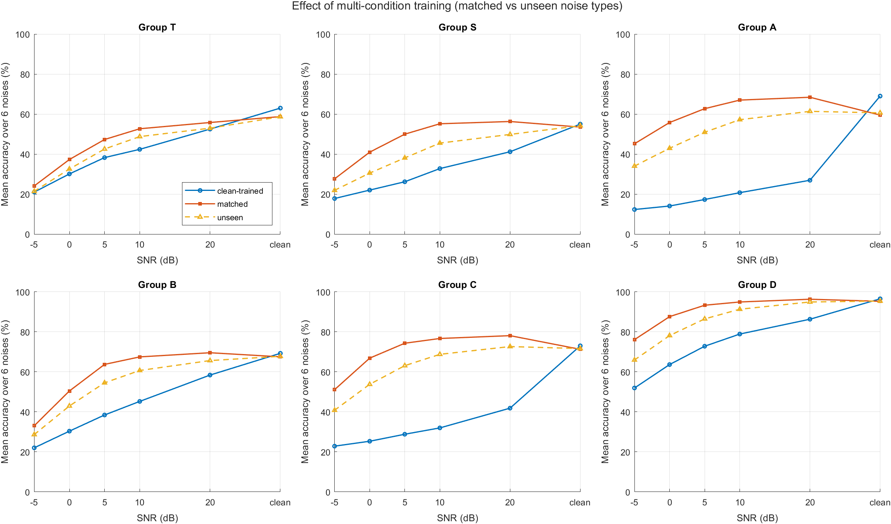

# Robustness of Interpretable Temporal and Spectral Features to Real-World Background Noise

ELEC5305 Acoustics, Speech and Signal Processing · The University of Sydney
Xinran He · SID 540662177

**Final report:** [final/report/ELEC5305_Final_Report_XinranHe.pdf](final/report/ELEC5305_Final_Report_XinranHe.pdf) · **Video:** _link to be added_ · **Proposal:** [PDF](ELEC5305%20Project%20Proposal.pdf) · **Progress report:** [PDF](ELEC5305_Project_Progress_Report.pdf)

## Research question

> How do different types of real-world background noise degrade ESC-10 classification based on interpretable temporal and spectral features, and how does this compare with a pretrained deep audio network?

The project reproduces the MFCC + ZCR baseline of Piczak (2015) on ESC-10 under the official folds. It then:

- compares temporal-only, spectral-only and combined handcrafted features;
- adds a pretrained deep reference (YAMNet embeddings classified with the same SVM);
- mixes every test clip with six real DEMAND noises at five SNRs;
- tests one modification: multi-condition (noise-augmented) training, including noise types never seen in training.

The interpretable features are used to explain *why* accuracy changes, not only to measure it.

## Key results

Mean accuracy (%) over the six noises, Gaussian SVM with nested tuning, 400 out-of-fold predictions:

| Group | Features | Dims | Clean | 20 dB | 10 dB | 0 dB | 0 dB after MCT (matched / unseen noise) |
|---|---|---|---|---|---|---|---|
| T | RMS, ZCR (temporal) | 4 | 63.0 | 52.5 | 42.4 | 30.1 | 37.3 / 32.5 |
| S | centroid, spread, flatness, rolloff (spectral) | 8 | 55.0 | 41.2 | 32.8 | 22.0 | 41.0 / 30.5 |
| B | T + S | 12 | 69.3 | **58.4** | **45.2** | 30.3 | 50.4 / 42.9 |
| A | MFCC + ZCR (Piczak baseline) | 26 | 69.0 | 26.9 | 20.7 | 14.0 | 55.8 / 42.9 |
| C | MFCC + T + S | 36 | **73.0** | 41.8 | 32.0 | 25.3 | **66.8 / 53.8** |
| D | YAMNet embeddings | 2048 | 96.5 | 86.3 | 78.9 | 63.6 | 87.6 / 78.1 |

**What the results show:**

- **Clean data:** temporal features beat spectral features (p = 0.005), six interpretable descriptors match the MFCC baseline, and combining them is best among handcrafted sets (+4.0 points over A, p = 0.04).
- **MFCCs fail first under noise.** Clean-trained MFCC models collapse already at 20 dB. At 20 dB, MFCC means shift by 0.5–1.25 within-class standard deviations, against 0.03–0.18 for the power-weighted descriptors. The reason is log compression of near-empty bands and of the digital silence that pads 10% of all ESC-10 frames.
- **Predictions get absorbed by one class.** Under noise, clean-trained MFCC models label most clips "clock tick". YAMNet's errors are semantic instead: river noise is labelled sea waves, traffic is labelled helicopter.
- **Multi-condition training is the modification that works.** It more than doubles the 0 dB accuracy of the combined handcrafted set and generalises to unseen noise types, at a cost of under 2 points on clean data.

## Repository layout

| Location | Contents |
|---|---|
| `final/code/` | Final experiment: the seven Live Scripts (run order under *How to run*) and the helper functions they call |
| `final/results/` | Results of the final runs (tables, figures, `.mat`), cached noisy features in `noise_features/`, listening examples in `s4_noise_…/examples/` |
| `final/report/` | Final report (PDF) |
| root `*.mlx`, `ESC10_prepared/`, `baseline_results/`, `feature_comparison_results/` | Progress-stage pipeline. Its clean features (`features_ABC.mat`) are the input to the final experiment |

## Requirements

- MATLAB R2024b. R2024a or later is needed for `audioPretrainedNetwork`.
- Audio Toolbox, Signal Processing Toolbox, Statistics and Machine Learning Toolbox.
- Deep Learning Toolbox and the YAMNet weights, only for the deep reference (group D). If they are missing, the steps run without group D.

## Data (not included in the repository)

1. **ESC-50** (always needed): download from https://github.com/karolpiczak/ESC-50 and place it so that `ESC-50-master/audio/` and `ESC-50-master/meta/esc50.csv` are in the repository root, as for the progress stage.
2. **YAMNet weights** (only for group D): run `audioPretrainedNetwork("yamnet")` in MATLAB once. If it reports missing files, download https://ssd.mathworks.com/supportfiles/audio/yamnet.zip and unzip it into `final/models/`. The scripts add that folder to the path automatically.
3. **DEMAND** (only to regenerate the noisy features, steps 3–5): from https://zenodo.org/records/1227121 download `TCAR_48k.zip`, `STRAFFIC_48k.zip`, `PCAFETER_48k.zip`, `DKITCHEN_48k.zip`, `NRIVER_48k.zip` and `OMEETING_48k.zip`. Unzip them into `final/DEMAND/` so that, for example, `final/DEMAND/TCAR/ch01.wav` exists. Only channel 1 is used.

DEMAND is **not** required to reproduce the results. The noisy features of every clip are cached in `final/results/noise_features/` (about 42 MB), so steps 4–6 run from the cache.

## How to run

Set MATLAB's Current Folder to `final/code` and run the Live Scripts in order. No paths need editing:

- each step writes a time-stamped folder in `final/results/` and records it in `latest_<step>.mat`;
- later steps read those records;
- the code finds the progress-stage data in the repository root automatically.

| Step | Script | What it does | Needs | Time* |
|---|---|---|---|---|
| 0 | `check_environment` | Checks toolboxes, data, DEMAND and YAMNet | – | < 1 min |
| 1 | `clean_tuned_eval` | Groups T, S, A, B, C on clean data; nested SVM tuning; McNemar tests | `features_ABC.mat` | ~12 min |
| 2 | `yamnet_clean` | Group D (YAMNet + SVM) on clean data; computational cost | ESC-50, YAMNet | ~6 min |
| 3 | `prepare_noise` | Verifies the feature extractor; characterises the six noises | ESC-50, DEMAND | ~4 min |
| 4 | `noise_robustness` | Clean-trained models on noisy test clips (6 noises × 5 SNRs) | steps 1 (+2); DEMAND **or** the cache | 2–40 min |
| 5 | `multicondition` | Multi-condition training, matched and unseen noise types | steps 1, 4; DEMAND **or** the cache | ~5 min |
| 6 | `analysis` | Explanatory figures and the summary table | steps 1, 3, 4 (+5) | < 1 min |

\*On a laptop CPU. To regenerate only the analysis figures from the included results, run `analysis` alone.

To recompute `features_ABC.mat` from the audio, run the progress-stage scripts in the repository root in this order: `prepare_esc10` → `configure_features` → `run_mfcc_zcr_baseline` → `run_feature_comparison`.

## Main references

- K. J. Piczak, "ESC: Dataset for environmental sound classification," ACM Multimedia 2015.
- J. Thiemann, N. Ito and E. Vincent, "The Diverse Environments Multi-channel Acoustic Noise Database (DEMAND)," Proc. Meetings on Acoustics 19, 2013.
- J. F. Gemmeke et al., "Audio Set," ICASSP 2017; S. Hershey et al., "CNN architectures for large-scale audio classification," ICASSP 2017.

The full reference list is in the report.
